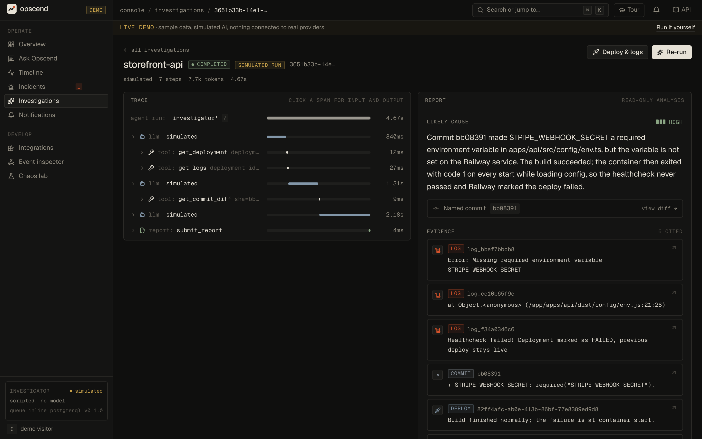
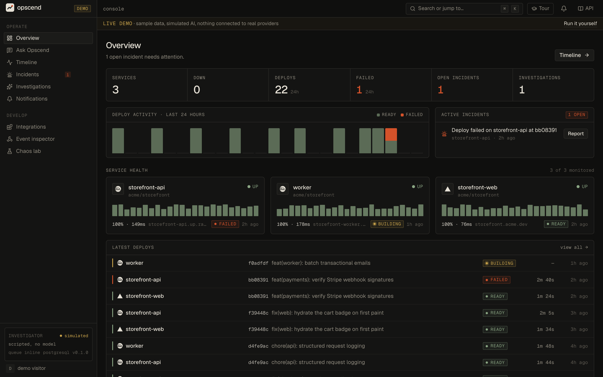
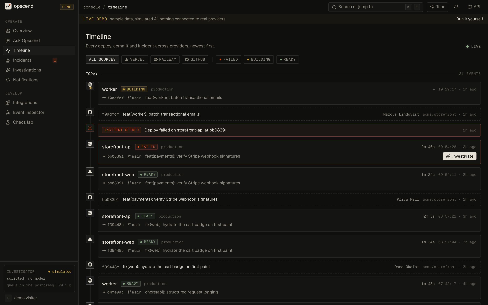
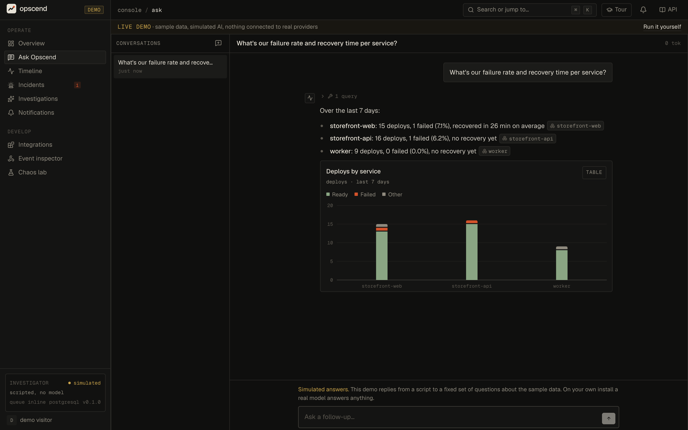
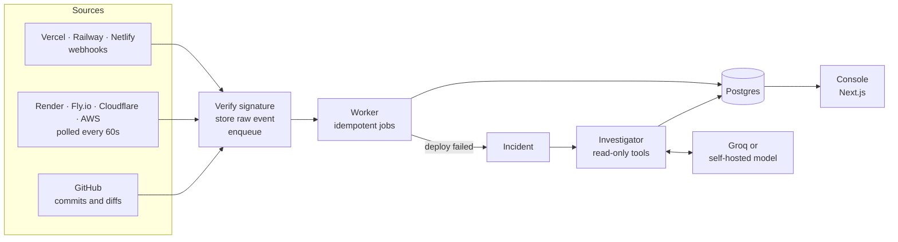

<div align="center">


# Opscend

**Know why the deploy broke.**

One timeline for every deploy and commit, an incident when something fails,<br />
and a read-only AI investigator that names the likely cause and cites its evidence.

[](https://github.com/abhi2k4/opscend/actions/workflows/ci.yml)
[](LICENSE)


[**Live demo**](https://opscend.abhishekthormothe.in) · [Quick start](#quick-start) · [How it works](#how-it-works) · [Providers](#providers) · [Self-hosted models](#self-hosted-models)

<br />

<a href="https://opscend.abhishekthormothe.in">
  
</a>

</div>

<br />

> Open source, self-hosted, single user. Bring your own LLM key or run the model yourself. The investigator has no write tools.

## Why Opscend

<table>
<tr>
<td width="33%" valign="top">

### One timeline

Deploys from Vercel, Railway, Render, Fly.io, Netlify, Cloudflare Pages and AWS, next to the GitHub commits that caused them.

</td>
<td width="33%" valign="top">

### A cause, with proof

A failed deploy is investigated as soon as its incident opens. Every log line, commit and deploy the report cites is checked against what the tools returned.

</td>
<td width="33%" valign="top">

### Yours to run

Read-only by design. Runs on Groq, or on a model you host, so logs and diffs never have to leave your network.

</td>
</tr>
</table>

## A look around

<table>
<tr>
<td width="50%"></td>
<td width="50%"></td>
</tr>
<tr>
<td align="center"><b>Overview</b><br />Service health, open incidents, latest deploys</td>
<td align="center"><b>Timeline</b><br />Every provider and every commit on one rail</td>
</tr>
<tr>
<td width="50%"></td>
<td width="50%"></td>
</tr>
<tr>
<td align="center"><b>Investigation</b><br />Live trace of each step, next to the cited report</td>
<td align="center"><b>Ask Opscend</b><br />Answers with citations and charts computed from your data</td>
</tr>
</table>

Screenshots are from the [live demo](https://opscend.abhishekthormothe.in), which runs on sample data with a scripted model.

## Quick start

### With Docker

```bash
cp .env.example .env        # set OPSCEND_SECRET_KEY, and GROQ_API_KEY or a self-hosted model
docker compose up
```

Open http://localhost:3000 and sign in with `OPSCEND_ADMIN_EMAIL` / `OPSCEND_ADMIN_PASSWORD` from your `.env`.

### Without Docker (local development)

No Postgres or Redis needed: the API falls back to SQLite and runs jobs in-process.

```bash
cp .env.example .env
make dev-api                # FastAPI on :8000  (needs uv)
make dev-web                # Next.js on :3000  (needs pnpm)
```

Demo mode (`OPSCEND_DEMO=1`, the default) seeds a sample storefront with a failed Railway deploy so every screen has data before you connect anything. The **Tour** button in the console walks through it (it needs `GROQ_API_KEY`, or `OPSCEND_AI_SIMULATED=1` to script the model's part).

## How it works



Webhook handlers verify the signature, store the raw event under a dedup key, and enqueue. All real work happens in the worker, idempotently, so a slow provider or a duplicate delivery never breaks ingestion.

```
api/   FastAPI · SQLAlchemy 2 · Alembic · arq
web/   Next.js App Router · Tailwind v4 · Motion
docs/  plan, provider guide
```

`web/lib/types.ts` is the API contract; `api/app/schemas.py` mirrors it.

## The AI investigator

- Runs on **Groq** by default (set `GROQ_API_KEY`), or on **a model you host yourself**: see [Self-hosted models](#self-hosted-models). Both go through the OpenAI-compatible chat API.
- Five read-only tools: `get_deployment`, `get_logs`, `list_recent_deploys`, `get_commit_diff`, `get_health_history`.
- **Runs by itself.** A failed deploy is investigated as soon as its incident opens, so the alert already carries the cause. Turn it off with `OPSCEND_AUTO_INVESTIGATE=0`; `OPSCEND_AUTO_INVESTIGATE_DAILY_LIMIT` (default 20) caps how many run per day.
- At most eight tool calls per run, with a token budget. Every step is stored as a span.
- The report must cite log lines, commits or deploys it actually saw. A report with no verified evidence is marked inconclusive, and one that cites only a commit (never the failure itself) is capped at low confidence.
- Log text is passed as untrusted data. Provider tokens never enter the model context.

### Measuring accuracy

`make eval` runs the investigator on 13 failures whose cause is known and scores each report. Use it before trusting a new model, and after changing the prompt, the tools or the evidence check.

```bash
make eval                                  # every case, once, with the configured model
make eval ARGS="--case timeout --runs 3"   # one case, three times
make eval ARGS="--min-accuracy 0.8"        # exit 1 below 80%
```

- **The cases** (`api/app/evals/cases.py`): nine where the deploy's commit is the cause, three where it is innocent (a registry outage, a build out of memory, a rotated database password), and one with no runtime logs, where the only right answer is "inconclusive". Two of them carry traps: an error that recovered by itself, and a log line that gives the model instructions.
- **The score:** a report is correct when it states the cause, names the right commit (or no commit), and cites a log line that shows the failure. The checks are string and id comparisons, not a second model, so a report always scores the same.
- **The outcomes:** `correct`, `abstained` (said inconclusive when the cause was in the logs), `wrong`, and `confidently wrong` (wrong at medium or high confidence), which is the one to drive to zero.
- It works in a throwaway SQLite database and never touches your data. It does spend tokens: about 10,000 per case.

### Self-hosted models

To keep logs and diffs on your own hardware, point Opscend at a local model server instead of Groq. No key is needed.

```bash
ollama pull qwen3:8b
```

```bash
# .env
OPSCEND_AI_PROVIDER=ollama
OPSCEND_AI_MODEL=qwen3:8b
```

```bash
make check-ai   # asks the model to call a tool and answer from the result
```

| `OPSCEND_AI_PROVIDER` | Default endpoint |
| --- | --- |
| `ollama` | `http://localhost:11434/v1` |
| `lmstudio` | `http://localhost:1234/v1` |
| `llamacpp` | `http://localhost:8080/v1` |
| anything else (`vllm`, `localai`, …) | set `OPSCEND_AI_BASE_URL` |

- **The model must support tool calling.** That is all the investigator and Ask Opscend do with it. `make check-ai` tells you whether yours does.
- **Docker:** the API container cannot see the host's `localhost`. Use `OPSCEND_AI_BASE_URL=http://host.docker.internal:11434/v1`, or run the bundled server with `docker compose --profile ollama up -d ollama` and use `http://ollama:11434/v1`.
- **Ollama's context window** defaults to a few thousand tokens, which cuts off build logs. Start it with `OLLAMA_CONTEXT_LENGTH=16384` or more (the bundled service does).
- **Speed:** a self-hosted model gets 300 seconds per reply and 4000 output tokens by default (`OPSCEND_AI_TIMEOUT_SECONDS`, `OPSCEND_AI_MAX_OUTPUT_TOKENS`). Small models are slower and less reliable at citing evidence than the Groq default; reports with no verified evidence are still marked inconclusive.
- If the endpoint wants a token, set `OPSCEND_AI_API_KEY`.

## Ask Opscend

A chat assistant over everything Opscend has collected. Ask "which services had failed deploys this week?", "search the logs for ECONNREFUSED" or "what's our failure rate and recovery time per service?".

- Same model settings and limits as the investigator (`OPSCEND_AI_MAX_TOOL_CALLS`, `OPSCEND_AI_TOKEN_BUDGET`, per answer).
- The investigator's five tools plus eleven read-only query tools: `list_services`, `search_deployments` (including by commit sha), `search_logs`, `list_incidents`, `list_commits`, `deploy_stats`, `deploy_trend`, `health_stats` (uptime, p50/p95, outages), `list_investigations` and `get_investigation` (reuse the investigator's reports, flagging ones rated wrong) and `changes_since_last_good`. Rates and percentiles are computed in the tools, not by the model, and cut-off results say so. There is no free-form SQL.
- It reads the intent first: a greeting or a question about itself gets a direct reply, and only questions about your data reach the tools.
- **Charts in answers.** Questions about trends, comparisons or response times get a chart in the reply (deploys per day or hour, deploys by service, response time). The numbers are computed by the tools from stored data, never written by the model, and every chart has a table view.
- Every `[deploy:…]`, `[log:…]` or `[commit:…]` citation is checked against what the tools actually returned; invented ids are removed before the answer is saved.
- Answers run as jobs (like investigations) and the UI polls for progress, so they work the same with inline jobs and the arq worker.
- Log search covers stored lines. On Postgres it uses a trigram index (`pg_trgm`, created by migration 0004 when the database user is allowed to).

Stored log lines and health checks older than `OPSCEND_RETENTION_DAYS` (default 30, `0` keeps everything) are deleted hourly.

## Providers

| Provider | Connect with | Deploys | Logs | Webhooks |
| --- | --- | --- | --- | --- |
| Vercel | Access token | yes | build, runtime (what the log stream returns in a few seconds) | yes |
| Railway | Account or workspace token | yes | build, runtime | yes |
| Render | API key | yes | build, runtime (last 6 hours of the service) | polled |
| Fly.io | Access token (`fly tokens create readonly`) | releases | runtime (the app's recent buffer) | polled |
| Netlify | Personal access token | yes | none (not in Netlify's public API) | yes |
| Cloudflare | API token with Pages: Read, plus account ID | Pages | build | polled |
| AWS | Read-only IAM access key, plus region | Amplify builds, ECS rollouts | Amplify build | polled |
| GitHub | Personal access token | commits and diffs | n/a | yes |

"Polled" means Opscend checks every 60 seconds instead of receiving a webhook. For AWS, the IAM user needs `amplify:List*`, `amplify:GetJob`, `ecs:ListClusters`, `ecs:ListServices` and `ecs:DescribeServices`; temporary (session-token) credentials are not supported.

### Adding a provider

A provider is one adapter file plus one registry line. See [docs/adding-a-provider.md](docs/adding-a-provider.md). The console reads the capability manifest from `/api/integrations/catalog`, so a new adapter shows up in Integrations without frontend changes.

## Every screen

| Screen | Route | What it does |
| --- | --- | --- |
| Landing | `/` | Pitch, animated demo, quick start |
| Overview | `/console` | Service health, open incidents, latest deploys |
| Ask Opscend | `/console/ask` | Chat with your deploy data: answers cite the deploys, log lines and commits they come from |
| Timeline | `/console/timeline` | Deploys, commits and incidents from all providers on one rail |
| Deploy detail | `/console/deployments/:id` | Build and runtime logs with level filters, commit diff, Investigate, and **What changed**: the commits, files and build time that separate this deploy from the last one that went live |
| Investigation | `/console/investigations/:id` | Live trace of every model turn and tool call, next to the cited report. Mark each report right or wrong; the list page counts the verdicts |
| Incidents | `/console/incidents` | Auto-opened on failed deploys and failed health checks |
| Notifications | `/console/notifications` | Bell in the top bar, full history, email alert status and a test button |
| Integrations | `/console/integrations` | Paste a token, test it, see the provider's capabilities |
| Event inspector | `/console/events` | Every raw webhook and poll result, with dedup state |
| Chaos lab | `/console/chaos` | Five scripted failures pushed through the real ingest pipeline |

Developer conveniences: `⌘K` command palette (type a question to send it to Ask Opscend), `g` + letter navigation, click-to-copy ids and SHAs, and interactive API docs at `/api/docs`.

## Notifications and email alerts

Opened and resolved incidents, finished investigations and integration errors show up under the bell in the console. To also receive them by email, set the `OPSCEND_SMTP_*` and `OPSCEND_EMAIL_*` variables in `.env` (any SMTP provider works) and restart the API and worker. `OPSCEND_EMAIL_EVENTS` chooses which events are emailed.

To try it without a real mail account, start the bundled test inbox and point Opscend at it:

```bash
docker compose --profile mail up -d mailpit
```

Then set `OPSCEND_SMTP_HOST=mailpit`, `OPSCEND_SMTP_PORT=1025`, `OPSCEND_SMTP_SECURITY=none`, plus any from and to address, and read the mail at http://localhost:8025.

## The public demo

The hosted demo is this same app with `OPSCEND_PUBLIC_DEMO=1`. It is a showcase, not a place to connect anything:

- **No login, and a private copy each.** Every visitor is a guest working in their own copy of the sample data (a Postgres schema or SQLite file per browser, `api/app/demo/sandbox.py`). Breaking a deploy, muting a service, asking a question or pressing Reset changes nothing for anyone else.
- **Nothing real is reachable.** Connecting, testing, syncing and deleting integrations, inbound webhooks, health-URL edits and test emails all answer 403 with a pointer to the quick start. No provider is ever called.
- **The model is simulated.** Investigations and Ask Opscend run the real read-only tools and the real evidence check, but the steps and conclusions come from a script (`api/app/demo/simulated.py`) that knows the scripted failures and a fixed set of questions. It uses no key, and the UI labels every run as simulated.
- **It cleans up after itself.** Actions are paced per visitor. A visitor's copy is deleted after `OPSCEND_PUBLIC_DEMO_SESSION_MINUTES` idle (default 120), at most `OPSCEND_PUBLIC_DEMO_MAX_SESSIONS` exist at once (default 300), and all of them are dropped when the API restarts. Setting `OPSCEND_PUBLIC_DEMO=1` on a database that was a real install deletes its connected accounts and their history.
- **A guided tour** starts on the first visit: break a deploy, see the incident open, read the report, look at what changed, ask a question.

<details>
<summary><b>Hosting your own public demo</b></summary>

<br />

To host one: set `OPSCEND_PUBLIC_DEMO=1`, `OPSCEND_SECRET_KEY` and `OPSCEND_COOKIE_SECURE=1` on the API, and build the web app with `OPSCEND_PUBLIC_DEMO=1`, `OPSCEND_LANDING_ONLY=0` and `OPSCEND_API_URL` pointing at the API. To try Opscend on your own deploys, with a real model, use the quick start above instead.

</details>

## Development

```bash
make test      # pytest, no live API calls
make lint
make check     # API lint and tests
make check-web # web type-check
make check-ai  # can the configured model call tools?
make eval      # how often does the investigator name the right cause?
```

## Status

v0.1. Adapters are written against the providers' public APIs and tested with recorded-style fixtures. Vercel, Railway and GitHub have been run against real accounts; Render, Fly.io, Netlify, Cloudflare and AWS have not yet. Not in scope: organizations, RBAC, any write action.

## License

[MIT](LICENSE). Provider logos are trademarks of their owners.
